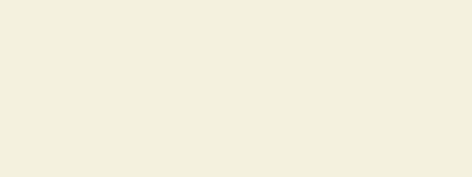

<div align="center">



<br><br>


</div>

---

##  Sobre o projeto

O **Arti.g** é uma galeria de arte online inspirada no **Pinterest**. A ideia é simples: artistas publicam suas obras em um feed visual e quem visita pode explorar, curtir, comentar, seguir os artistas favoritos e, se se apaixonar por alguma peça, comprar direto com quem criou, numa conversa pelo **WhatsApp**.

Qualquer pessoa pode navegar pela galeria sem cadastro. O cadastro só é pedido na hora de interagir: deixar um feedback, curtir ou comprar. E todo visitante pode **virar artista** quando quiser, só completando o perfil.

##  Funcionalidades

| 👀 Visitante anônimo | 🛍️ Visitante cadastrado | 🎨 Artista |
|---|---|---|
| Ver o feed de obras | Tudo do anônimo + | Tudo do visitante + |
| Buscar obras e artistas | Curtir obras | Publicar obras |
| Filtrar por categoria | Comentar (feedbacks) | Editar e excluir as próprias obras |
| Ver o perfil dos artistas | Seguir artistas | Marcar obra como vendida |
| | Comprar via WhatsApp | Responder e moderar comentários |
| | Editar perfil e foto | Ver seguidores, curtidas e vendas |

##  Tecnologias

O projeto é dividido em duas camadas que conversam por uma **API REST** em JSON:

- **Back-end:** Symfony 8.1 + Doctrine ORM, autenticação **JWT** (LexikJWTAuthenticationBundle), CORS (NelmioCorsBundle), Serializer com grupos para nunca expor senha ou CPF/CNPJ, e Voters para controlar quem pode editar o quê.
- **Front-end:** React.
- **Banco de dados:** MySQL / MariaDB, com 8 tabelas e relações **1:1**, **1:N** e **N:N**.

##  Estrutura do repositório

```
Arti.g_Projeto/
├── back_end/      API em Symfony (entidades, controllers, regras de negócio)
├── front_end/     Interface em React
└── docs/gifs/     As animações deste README
```

A documentação completa da API (endpoints, exemplos de requisição e formato dos erros) está em **[`back_end/README.md`](back_end/README.md)**.

##  Como rodar

**Pré-requisitos:** PHP 8.4+, Composer, MySQL/MariaDB (o XAMPP serve) e Node.js.

```bash
# 1. Back-end
cd back_end
composer install
# crie o arquivo back_end/.env.local com:
# DATABASE_URL="mysql://root:@127.0.0.1:3306/artig?serverVersion=10.4.32-MariaDB&charset=utf8mb4"
php bin/console lexik:jwt:generate-keypair
php bin/console doctrine:database:create
php bin/console doctrine:migrations:migrate
php bin/console doctrine:fixtures:load     # dados de exemplo
php -S localhost:8000 -t public
```

A API fica em `http://localhost:8000/api`. Para testar, abra `http://localhost:8000/api/obras` no navegador.

> 🔑 **Logins de exemplo** (senha `senha123`): `visitante@artig.com` · `ana@artig.com` (artista) · `bruno@artig.com` (artista)

##  Regras de negócio

- ✅ Uma obra **vendida** continua no feed por 7 dias marcada como esgotada, sem receber curtidas e sem o botão de comprar.
- ✅ O artista **pode curtir** a própria obra, mas **não pode seguir** a si mesmo.
- ✅ Excluir uma obra ou comentário **não apaga** curtidas e comentários do banco (exclusão lógica, sem cascade).
- ✅ Um visitante pode **virar artista** depois, completando o perfil com CPF ou CNPJ.
- ✅ O valor da obra é definido livremente pelo artista. Comentários têm até **5000 caracteres**.
- ✅ CPF/CNPJ são validados pelo dígito verificador e **nunca** aparecem nas respostas da API.

##  Quem somos

| Nome | RA |
|---|---|
| Nome do integrante 1 | 000000 |
| Nome do integrante 2 | 000000 |
| Nome do integrante 3 | 000000 |

<div align="center">
<br>

<br>
<sub>Feito com carinho (e muitas pinceladas de código) para o projeto da faculdade.</sub>
</div>
